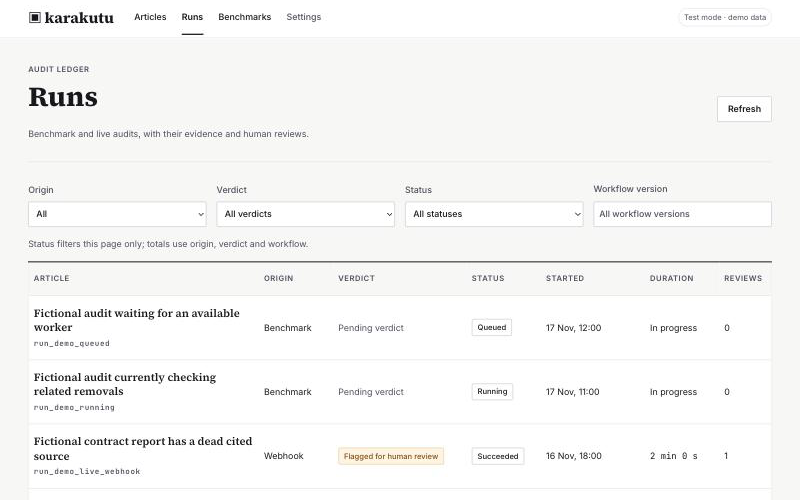

# karakutu-ai-audit

A workbench for auditing removed news articles. You give it an article that disappeared from a
news site; a six-step workflow looks for where it went (moved, copied elsewhere, still live, or
gone) and records every piece of evidence, search and model call behind its answer. A person
then reviews that evidence and decides.

**No result is a finding of censorship.** `POSSIBLE_CENSORSHIP` is a flag that nominates an
article for human review. `MOVED`, `FOUND_ONLINE` and `NOT_REMOVED` say nothing about why an
article was removed.



## What it is

- A **review UI** (React, TypeScript) to submit cases, watch each step and record whether you
  agree with the result.
- An **API and workflow** (FastAPI, LangGraph) that runs six ordered steps, uses a language
  model to find and describe evidence, and picks the verdict with deterministic rules.
- A **durable record** (SQLite by default, optional PostgreSQL) of every run: input, each step's evidence, exact model requests
  and responses, and a fingerprint of the code, settings and prompts that produced it.

## What it is not

- Not an authority. It flags; people decide.
- Not a publisher. It reads from an archive but never writes back to one.
- Not a hosted service. It runs on your machine, on loopback by default, as one process.

## Quick start: test mode in 5 minutes

Test mode needs only Docker (Compose 2.24 or newer) and `make`. It uses a fictional demo dataset
and an offline demo engine: no model, no search, no network calls, no settings.

```sh
git clone https://github.com/karakutu-xyz/karakutu-ai-audit.git
cd karakutu-ai-audit
make test
```

Open http://localhost:2201. You get 28 demo runs covering every verdict and run state, three
workflow versions to compare, and reviewer reactions. Everything in it is made up. Stop it with
`make down`.

To audit real articles, run live mode with your own model: see
[Getting started](docs/getting-started.md). For a server, see [Docker deployment](docs/deploy-docker.md).

## Web UI

Articles is the start page (`/articles`). Search the ledger and filter by audit
status, latest verdict or category: All articles (default), Live articles or
Benchmark cases. Open an article to read the latest audit story, step evidence, removed text
and snapshot versions, alongside human review and its run history.

Choose **Run first audit** or **Re-run audit** to start a new run; earlier runs
stay in history. A running audit updates as steps finish. **Open full run** shows
the exact saved records. Runs and Benchmarks remain available from the top bar;
Connection settings holds the optional in-memory API token.

## Documentation

| Read | To learn |
| --- | --- |
| [Getting started](docs/getting-started.md) | Test mode, live mode, Docker and Tilt, settings, common problems |
| [Configuration](docs/configuration.md) | Every environment variable, secrets and how commands load settings |
| [Architecture](docs/architecture.md) | How the parts fit, with links to the code, and a glossary |
| [Workflow](docs/workflow.md) | The six steps, the verdict rules, and how to change a prompt or rule |
| [Data and API](docs/data-and-api.md) | Storage, every API route, access control and data hygiene |
| [Audit record schema](docs/audit-record-schema.md) | Lean v2 results, record limits and explicit private review details |
| [Contributing](docs/contributing.md) | Dev setup, the six checks, tests, and the rules for changes |
| [Web UI](web/README.md) | How the review UI is built |
| [Changelog](CHANGELOG.md) | What changed |

## Project layout

```text
backend/audit/      API, workflow engine, steps, storage, provenance
backend/tests/      pytest suite (offline, fabricated inputs)
web/                review UI (React, Vite)
docs/               guides
scripts/            setup, demo seeding, benchmarks, OpenAPI export, data-hygiene check
searxng/            settings for the bundled SearXNG search engine
compose*.yaml       Docker stacks; the Makefile wraps test and live mode
Tiltfile*           hot-reload development
```

## Data

No real article data lives in this repository. Article corpora, databases, reports and
settings are ignored by Git and stay in your local `data/` folder or `.env`. The data-hygiene
check keeps it that way; see [Contributing](docs/contributing.md#ground-rules).

## License

[Apache License 2.0](LICENSE).
