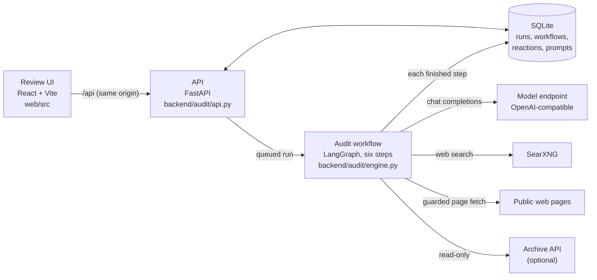
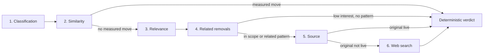

# Architecture

This page is the map. It names each part, says what it owns and links to the code. The rules
themselves live in [the workflow guide](workflow.md) and [the data and API guide](data-and-api.md);
this page links to them instead of repeating them.

## The big picture

One process runs the API and the workflow. A submitted article becomes a queued run in SQLite;
an in-process task then runs the six steps and saves each step as it finishes. The UI
reads runs, appends reviewer reactions and controls local execution (stop audits or
pause the queue). Nothing writes back to the archive.

In test mode the workflow box is replaced by an offline demo engine, and the model, SearXNG,
web and archive boxes are not used at all (see [Test and live mode](#test-and-live-mode)).

## Where things live

| Path | What it owns |
| --- | --- |
| [`backend/audit/api.py`](../backend/audit/api.py) | FastAPI app, startup order, request guards (host, token, origin, body size), routes, the in-process run queue. |
| [`backend/audit/engine.py`](../backend/audit/engine.py) | The LangGraph graph (`AuditEngine`), the step wrapper that records every step, the SearXNG client (`Search`), model discovery. |
| [`backend/audit/workflow/`](../backend/audit/workflow) | One module per step, the prompts ([`prompts.py`](../backend/audit/workflow/prompts.py)), the prompt registry ([`prompt_registry.py`](../backend/audit/workflow/prompt_registry.py)) and the verdict rules ([`pipeline.py`](../backend/audit/workflow/pipeline.py)). |
| [`backend/audit/search/`](../backend/audit/search) | Guarded page fetching ([`fetch.py`](../backend/audit/search/fetch.py)), URL rules ([`urls.py`](../backend/audit/search/urls.py)) and measured text matching ([`textmatch.py`](../backend/audit/search/textmatch.py)). |
| [`backend/audit/model.py`](../backend/audit/model.py) | A small OpenAI-compatible JSON adapter. It records every request and raw response for review. |
| [`backend/audit/clients/`](../backend/audit/clients) | The read-only archive client, its optional wallet sign-in, and the topic catalog used by classification. |
| [`backend/audit/db.py`](../backend/audit/db.py) | SQLAlchemy tables, numbered migrations and the `Store` used by the API. |
| [`backend/audit/provenance.py`](../backend/audit/provenance.py) | The workflow snapshot and its fingerprint. |
| [`backend/audit/config.py`](../backend/audit/config.py) | `Settings`, read from the environment once at startup. |
| [`backend/audit/domain.py`](../backend/audit/domain.py) | Verdicts, flags, step names and the request and response models. |
| [`backend/audit/schemas.py`](../backend/audit/schemas.py) | API request and response models; they generate [`openapi.json`](../openapi.json). |
| [`backend/audit/demo.py`](../backend/audit/demo.py), [`demo_engine.py`](../backend/audit/demo_engine.py) | The fictional demo dataset and the offline engine used in test mode. |
| [`web/src/`](../web/src) | The review UI: [`router.tsx`](../web/src/router.tsx) (page addresses), [`pages/`](../web/src/pages) (one file per screen), [`api/client.ts`](../web/src/api/client.ts) (the only HTTP code) and [`api/hooks.ts`](../web/src/api/hooks.ts) (loading and polling), [`types.ts`](../web/src/types.ts) (API types), [`styles/tokens.css`](../web/src/styles/tokens.css) (colours, type and spacing). See [`web/README.md`](../web/README.md). |
| [`scripts/`](../scripts) | Setup, demo seeding, batch benchmarks, OpenAPI export and the data-hygiene check. |

## Life of a run

1. A client posts an article to `POST /api/benchmarks/runs` (or a live route, if enabled), or
   asks for an audit of a stored article with `POST /api/articles/{ref}/audit`. `submit` in
   [`api.py`](../backend/audit/api.py#L460) saves a `queued` run and links it to its article in
   the same transaction. The run records the current workflow, prompts and step models at this
   moment.
2. An `asyncio` task waits for a free slot (`MAX_CONCURRENT_RUNS`, default 1), marks the run
   `running` and calls `AuditEngine.run`.
3. Each step goes through the `_node` wrapper in [`engine.py`](../backend/audit/engine.py#L221).
   The wrapper stores the step's input, output, model calls, evidence and duration as soon as
   the step ends, so a reviewer can watch a run progress.
4. When a step stops the audit early, the remaining steps are still recorded as skipped. Every
   run that completes, including `AUDIT_FAILED`, shows all six steps. An interrupted or
   operator-cancelled run keeps the steps saved so far.
5. The engine picks the verdict (next section). The run ends `succeeded`, or `failed` when the
   verdict is `AUDIT_FAILED`.
6. An operator may stop a queued/running audit as terminal `cancelled`, without a
   verdict or output. Queue pause holds queued work and leaves running work alone;
   it resets on restart. See [run controls](data-and-api.md#run-and-queue-controls).
7. If the process stops mid-run, the next start marks the run `failed` with error
   `interrupted` (`Store.interrupt_incomplete` in [`db.py`](../backend/audit/db.py#L288)). Runs are
   never replayed silently; submit again to retry.

## The six steps

The graph is built in `AuditEngine.__init__` in [`engine.py`](../backend/audit/engine.py#L158).
The order is fixed by `NAMES`:

| # | Step | Code | Uses | Can end the audit early |
| --- | --- | --- | --- | --- |
| 1 | Classification | [`classification.py`](../backend/audit/workflow/classification.py) | model, topic catalog | Only when the model is disabled (`AUDIT_FAILED`); other failures are recorded and the audit goes on |
| 2 | Similarity | [`similarity.py`](../backend/audit/workflow/similarity.py) | archive, page fetch, text matching | Yes: a measured move to the same publisher gives `MOVED` |
| 3 | Relevance | [`relevance.py`](../backend/audit/workflow/relevance.py) | model | Only on model failure (`AUDIT_FAILED`) |
| 4 | Related removals | [`related_removals.py`](../backend/audit/workflow/related_removals.py) | archive, model | Yes: low public interest and no related pattern gives `LIKELY_LOW_PUBLIC_INTEREST` |
| 5 | Source | [`source.py`](../backend/audit/workflow/source.py) | page fetch, model, search | Yes: the original page is live with its text gives `NOT_REMOVED` |
| 6 | Web search | [`web_search.py`](../backend/audit/workflow/web_search.py) | search, page fetch, model | Ends the graph; model failure gives `AUDIT_FAILED` |

A "not relevant" answer at step 3 does not stop the audit by itself. Step 4 runs first: a
pattern of related removals keeps the article in scope. What each step reads and writes, and
the thresholds, are in [the workflow guide](workflow.md).

### The deterministic decision

Models find and describe evidence. They never pick the verdict. Code does:

- `_decide_verdict` in [`pipeline.py`](../backend/audit/workflow/pipeline.py#L149) turns measured
  evidence into `NOT_REMOVED`, `MOVED`, `LIKELY_MOVED`, `FOUND_ONLINE`, `POSSIBLE_CENSORSHIP`
  or `INCONCLUSIVE`. A live original wins first, then a relocation, then independent copies,
  then dead copies of the same story; anything else is `INCONCLUSIVE`.
- `AuditEngine.run` in [`engine.py`](../backend/audit/engine.py#L332) handles the two exits that
  are not about evidence: low public interest and failed execution (`AUDIT_FAILED`).
- Text overlap is measured, not judged. The thresholds are constants in
  [`textmatch.py`](../backend/audit/search/textmatch.py#L51): 0.99 containment for a move, 0.30
  for a partial match.
- Two flags can be added to a verdict: `SOURCE_DEAD` (a cited source answers 404 or 410) and
  `RELATED_REMOVALS` (a pattern of related removals). Both are defined in
  [`domain.py`](../backend/audit/domain.py#L61).

Every `POSSIBLE_CENSORSHIP` explanation says that it is not a finding of censorship and that a
person must review it.

## Data model

SQLite through SQLAlchemy, one file per mode (`data/audit.sqlite3` live,
`data/demo/audit-test.sqlite3` test). Tables are defined in [`db.py`](../backend/audit/db.py):

| Table | Holds | Changes |
| --- | --- | --- |
| `workflows` | Workflow snapshots, keyed by fingerprint | Insert only |
| `articles` | One article per normalized URL: title, source, host, dates, content, archive metadata, category and origin (`run`, `archive`, `demo`) | Created by its first run, an archive import or the test-mode demo seed (which includes articles with no run yet); imports and archive fills update metadata and missing text |
| `runs` | Input, status, verdict, every step with model calls and evidence, category, origin and `article_ref` (the linked article) | Status and steps fill in while running; input never changes |
| `reactions` | Reviewer reactions on a run | Append only |
| `prompt_versions`, `prompt_activations` | Every prompt text ever stored, and which one is active | Append only |
| `model_assignments` | Per-step model choices made through the API | Append only |

Runs and steps keep evidence as JSON, so evidence formats can grow without a migration. Schema
changes are numbered migrations tracked with `PRAGMA user_version`; migration 4 added `articles`
and `runs.article_ref` and linked existing runs to articles. The rules for adding one,
plus the full column list and every route, are in [the data and API guide](data-and-api.md).

## Provenance and the workflow fingerprint

Every run points to an immutable workflow snapshot. `build_base` and `with_prompts` in
[`provenance.py`](../backend/audit/provenance.py#L32) build it from:

- the source of every Python file under `backend/audit/`;
- the locked dependencies (`pyproject.toml`, `uv.lock`), the Compose files and the SearXNG
  settings;
- the behaviour settings (model endpoint and names, sampling limits, search provider, archive
  posture);
- the active prompt texts and the step models.

The workflow ID is `wf_` plus the SHA-256 of that definition. Secrets, timestamps, file paths,
prompt authors and notes are left out, so the same code and settings always give the same ID.
Change a prompt, a rule or a model, and new runs get a new ID while old runs keep theirs. That
is how you compare two versions of the workflow on the same benchmark cases. More in
[Change a prompt or rule](workflow.md#change-a-prompt-or-rule).

## Test and live mode

`RUN_MODE`, read in `Settings.from_env` in [`config.py`](../backend/audit/config.py#L309), chooses the mode at startup.

| | Test | Live |
| --- | --- | --- |
| Engine | `DemoEngine` ([`demo_engine.py`](../backend/audit/demo_engine.py)): offline, deterministic, fabricated step records | `AuditEngine`: real model, search, page fetches and optional archive reads |
| Database | `data/demo/audit-test.sqlite3`; only a test database is accepted (named `*-test.sqlite3` or under `data/demo/`) | `data/audit.sqlite3`; a test database, or any file holding demo data, is refused |
| Demo data | Seeded by `audit.demo.seed()` on every start | None |
| Settings read | Access settings only (`DATA_DIR`, `API_AUTH_TOKEN`, `ALLOWED_HOSTS`, `ALLOWED_ORIGINS`, `MAX_CONCURRENT_RUNS`) | All of `.env` |
| UI | **Test mode · demo data** pill in the top bar | **Live** pill in the top bar |

Test mode exists so anyone can explore every screen without a model or private data. Its
results are demo output, not audits. How to start each mode is in
[Getting started](getting-started.md).

## Limits by design

- One process. The run queue is in memory, so run one API process with one worker. Do not add
  replicas or uvicorn workers.
- No archive writes. The archive client has read methods only.
- No remote tracing. LangSmith is turned off; transcripts stay in the local database.
- Results depend on the model and on what search can find. A missing search hit is not
  evidence of anything.

## Glossary

**Verdicts** (`Verdict` in [`domain.py`](../backend/audit/domain.py#L9)):

| Verdict | Meaning |
| --- | --- |
| `NOT_REMOVED` | At audit time the original URL answered with the article text measurably intact. It may have been restored or the removal may be intermittent; never exculpatory. |
| `MOVED` | A live page at the same publisher contains at least 99% of the original text. Says nothing about why the original URL went away. |
| `LIKELY_MOVED` | A live same-publisher page with a partial measured fit, or a fit that could not be measured. A person should check whether the differences matter. |
| `FOUND_ONLINE` | Independent copies of the article exist elsewhere. Says nothing about why it disappeared. |
| `POSSIBLE_CENSORSHIP` | Copies of the story existed and are now gone with nothing live left, or a same-publisher copy drops key facts. A flag for human review, never a finding of censorship. |
| `INCONCLUSIVE` | The evidence does not support any other verdict. |
| `LIKELY_LOW_PUBLIC_INTEREST` | The model judged the article of low public interest and no related-removal pattern kept it in scope. |
| `AUDIT_FAILED` | The audit could not be completed (model disabled or failing, invalid model output). The article was not audited and must be run again. Not a finding. |

**Flags:** `SOURCE_DEAD` (a cited source is gone with 404 or 410) and `RELATED_REMOVALS`
(at least three confirmed related removals across at least two publishers, or one a human
already marked).

**Run states:**

- `queued`: saved and waiting for a slot.
- `running`: steps in progress.
- `succeeded`: finished with a verdict.
- `failed`: `AUDIT_FAILED`, or error `interrupted` when the service stopped mid-run.
- `cancelled`: stopped by an operator; retains recorded steps without a verdict.

**Category and origin:** `benchmark` runs come from the UI or `scripts/benchmark.py` (origin
`benchmark`); `live` runs come from the gated `POST /api/audit` (origin `api`) and
`POST /api/webhooks/audit` (origin `webhook`) routes. `POST /api/articles/{ref}/audit` gives a
stored article its first audit or a re-run in either category: the run keeps the article's
category and uses origin `article`. Outside test mode, auditing a `live` article needs the same
live gate as the live routes.

**Workflow version:** an immutable snapshot of code, settings, prompts and models, named by
its fingerprint (`wf_…`). See [Provenance](#provenance-and-the-workflow-fingerprint).

**Run mode:** `test` (offline demo engine and demo data) or `live` (real integrations). See
[Test and live mode](#test-and-live-mode).

**Reaction:** a reviewer's `agree`, `disagree` or `needs_review`, with an optional note and
expected verdict. It is appended to the run and never changes the machine result.
